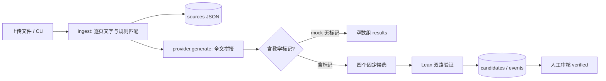
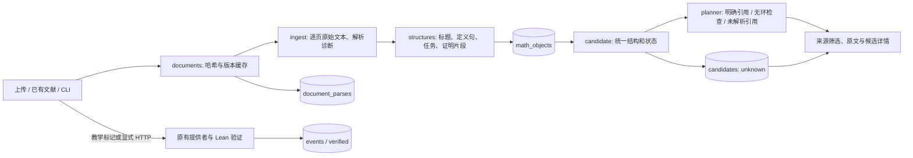

# v0.2.1 架构与代码审查

## v0.1 实际调用链

逐文件审查结论：

1. `ingest.py` 确实读取 PDF 全部页面；不是上传失败。旧 `pipeline.py` 把全文传给 `provider.generate`，但未传入提取对象作结构化候选。`MockProvider.generate` 明确仅接受 `MATHLIB2_DEMO_NAT` 标记，因此 source 8 返回空数组是实现限制。
2. `extracted` 是 `len(source['objects'])`，与候选数量没有必然关系。旧规则只支持四类词，PDF 仅匹配单行，表格中的 `Definition Given` 也可能成为误报。本次保留的旧 source 8 记录仍是 1 个对象，并未篡改历史。
3. 原始 `Store.add` 每次插入来源及候选；重复执行会增加记录。未发现 parser 单次重复读取调用，但前端把所有来源、所有候选一起显示，导致用户看到旧 nat 记录。来源外键数字没串，但视图缺少来源隔离。
4. HTTP 提供者接收最多 30000 字符，输出受限 Lean 字符串，与文献结构模型没有统一层；现保留其接口和显式启用方式。默认真实文献路径完全不调用 HTTP。
5. 原有 Lean 核心未修改；状态入口仍为真实编译和公理审计。失败、超时与无反例继续归为 unknown。

## v0.2.1 模块

规则强度只是启发式置信度。标题、练习题、定义句的识别不能证明数学命题正确。图注保留为 Extracted/uncertain，无法从图注恢复的内容不会编造。跨页不自动拼接；偏移使用原始逐页 Unicode 字符串，不做影响定位的清洗。

`Candidate` 视图统一含 candidate_id、source_id、title、statement、object_type、original_text、location、mathematical_domain、dependencies、extraction_method、confidence、formalization_status、verification_status。新增记录还含识别理由、前后文和 proof_steps；旧记录通过 `candidate.view` 兼容读取。

阶段：Extracted（不确定片段/证据）→ Candidate（规则识别的数学对象）→ Formalized（有 Lean 表述）→ Lean Verified（严格门禁通过）→ Human Approved（人工审核）。它们与 proved/refuted/unknown 分开；规则候选一律 not_formalized/unknown。不是所有片段都会晋升候选或产生证明。

## 数据库兼容迁移

- 原 `sources/candidates/events/verified` 全部保留，旧 payload 不改写。
- 新表 `document_parses(source_id, version, payload)`：联合主键，保存每次解析器版本下的全文、对象和诊断。
- 新表 `math_objects(id, source_id, object_key UNIQUE, payload)`：稳定定位对象，键包括来源、解析器版本、页码、偏移和类型。
- `candidates` 增加可空 `dedup_key`，建立唯一索引。旧行保持 NULL；通用候选按 object_key 去重，教学生成候选按来源/命题/策略去重。
- 初始化迁移可重复执行。重复上传相同字节复用最早 source_id 与版本解析缓存；旧版已存在的重复来源保留，避免破坏关联。改变文献字节会产生新来源；以后改变解析规则需更新解析器版本。
- 修改前使用 SQLite backup API 保存 `data/backup-before-v021.sqlite`。上线回归比较备份中的所有旧行，确认旧数据未删除或改写。

## DAG 契约

节点使用候选 ID 和原文定位；边方向为被依赖节点 → 使用者。`basis` 必须为 explicit、rule_hypothesis、ai_hypothesis 或 human。当前仅从 by/using/from + 编号命题生成 explicit 边；重复标签或找不到声明放入 unresolved。`validate_graph` 检查端点、重复节点、环和来源标签。含环图返回 invalid，并保留 rejected_edges 供检查。推测类型只是预留接口，当前没有 AI 生成边。

## 边界

未引入 OCR、嵌入向量、大模型或大型文档框架。新增 fontTools 修复实际 PDF 的 CFF 字体解码警告。手写图、跨页指代和未编号证明可能漏检；目前不承诺恢复整篇论文的全部数学结构。未知遗漏数不能伪装成“0 个识别失败”。
