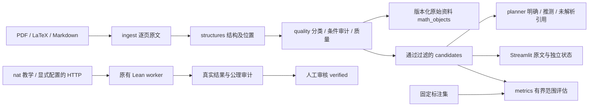

# v0.2.2 增量架构与数据变化

继续使用原有 Python、SQLite、Streamlit 和 Lean 工程，没有重写。

## 问题与处理

- 原先每个识别片段都写入 candidates，导致图注等 Extracted 资料混入候选列表。现在全部保留为 math_objects，仅 eligible 进入本版候选表。
- 通过正文定义识别丰盈数专题；不按文件名或哈希匹配提取规则。该专题下其他练习被标 out_of_scope，仍可查看完整原文。通用论文不强制套用此专题。
- original_statement 原样；normalized_statement 只合并空白；lean_statement 为 null，直到真实形式化。边界风险和修正建议不能更新 verification_status。
- relevance_score（0/1）、mathematical_completeness、extraction_confidence、source_traceability（切片一致性）、semantic_risk 均有规则解释。没有概率校准，不代表真值。4个论文候选均为 Medium Confidence。
- DAG 明确引用支持 by/using/from/apply/applying/according to/follows from 编号声明。定义词使用为 rule_hypothesis，明确标 Inferred Dependency；不按相邻位置建边。循环图返回 invalid 并隔离边。
- 数学标题类型仍支持原有8类；新增 SourceMaterial 用于图表和普通引用，不能冒充 Proof。

## SQLite

无需新增表或删除列。沿用 sources、candidates、events、verified、document_parses、math_objects。

document_parses 的键为(source_id,version)。本版版本0.2.2；math_objects.object_key和candidates.dedup_key包含版本。新增质量和语义字段存入JSON payload，candidates新增parser_version字段也是JSON属性。

读取默认版本更新为0.2.2，显式 store.document(source_id,'0.2.1') 仍可读取历史解析。页面及DAG仅关联本版候选，历史记录只读保留。原有Lean事件和已审核知识不改变。

升级前备份 data/backup-before-v022.sqlite；实际升级从53条候选增加为57条，其余来源8、事件120、已批准0保持。逐行比较确认旧记录未改。

## 局限

本版没有OCR、跨页语义拼接、一般数学真值判定或自动Lean翻译。语义审计主要为保守文本保真及丰盈数专项边界检查；不能宣称通用语义等价检测。图内依赖、模糊指代和没有明确标题的定义可能漏检。

小型标注集已逐项对照原文及渲染图像核读，但标注者是助手，真人独立复核未完成。指标仅针对标注范围，不是全篇或其他论文准确率。
