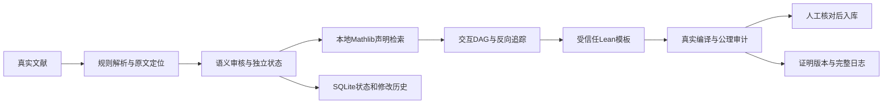

# Mathlib2 v0.3 交付与实际验收

## 真实 Lean 结果

Mason–Stothers 论文第4页 Lemma1：非零多项式 a 的 a/rad(a) 整除导数。核对第2页radical定义和第8页作者Lean代码后，新建声明保留a≠0假设，复用本地Mathlib的divRadical_dvd_derivative。它适用于任意域，不要求CharZero；Lean声明另带DecidableEq k用于定义的实例解析，不是增加域特征假设。

源码：lean/Research/Lemma1.lean。成功的实际日志：reports/lemma1-v03-6b63b4e3a0564d9d84ea9bb2f28e77ad.json。Lean4.24.0返回0，依赖公理仅propext、Classical.choice、Quot.sound，无sorry/admit。新声明类别为Theorem Reuse，不是New Proof；作者与源码位置保存在provenance中。

先前缺少Radical.olean及NormalizationMonoid实例的失败日志保留在lemma1-v03-*.json，失败结果没有被标为已验证。补齐模块缓存并显式声明DecidableEq后成功。

## 两篇论文

|论文|原始片段|正式候选|保留资料|不确定片段|
|---|---:|---:|---:|---:|
|Abundant Numbers|39|4|35|28|
|Mason–Stothers|50|16|34|3|

A的候选数量保持，uncertain改为按实际recognition_status统计，不再只数Low Confidence。k=1、两素数均为2均记录潜在反例，验证状态仍unknown。B的增加主要来自代码片段单独识别及证明分离，不能把50个片段说成50条定理。B正式对象含6Theorem、3Lemma、2Definition、3Proof、1Conjecture、1Corollary。

保留原文、逐页字符区间、statement_text/proof_body/code_fragments、保守规范化审计、语义字段。可确定的词黏连可以分开；不能可靠恢复的上下标仍标风险，不猜测公式。详细解析报告parsing-v03.md；实际数据库回归regression-v03.json。

## 工作台与架构

保留旧LeanWorker、Mock/HTTP提供者、来源和候选表。新增workbench控制阶段流转，formalization控制实际模板编译，retrieval增加全目录声明检索，research_ai独立提供可选外部建议接口。DAG搜索候选边与真实证明使用边分开，定义使用不是证明依赖。

新增workbench_state、workbench_history、proof_runs表；自动备份，可通过关闭程序后恢复备份回滚。候选原文不覆盖；修改规范化文本会使旧编译失效。已批准版本禁止覆盖。

## 七页操作

1. 研究首页查看实际数据库统计和十阶段状态。没有数据时提供导入入口。
2. 文献管理上传或选择当前文献，逐阶段查看结果、原文和历史解析。重复字节文件复用。
3. 候选审核左右对照，填写审核人、理由；拒绝或修改需勾选确认。批准候选不等于入库。
4. Proof DAG可缩放拖动和选择节点/边，另有备用选择框、来源证据和反向依赖；虚线为推测。
5. Mathlib检索显示真实声明、命名空间语法推断、位置与匹配类别；检索结果持久化。
6. Lean Lab载入内置声明/证明模板，实际编译并保存每次日志，失败可重试。不是通用自由代码执行器，也不是AI自动证明器。
7. 知识库只允许当前语义审核和编译都满足门禁的对象入库，必须填写一致性意见。生产库没有自动模拟真人批准。

## 验证

完整41项测试通过（48.711秒），含旧nat四候选真实Lean、两篇PDF、源码定位、迁移、版本失效、窗口导航和真实Lemma1。端到端测试在临时数据库中模拟审核用户，真实调用Lean并测试审批；测试记录不写入生产知识库。完整输出tests-v03.txt。

mypy检查app.py及ui_graph.py通过。实际Streamlit服务七页导航、真实PDF流程、4候选和边界提示检查通过，异常0，使用独立测试数据库；服务结束后关闭。日志ui-server-v03.log，快照ui-snapshot-v03.json。

## 尚未覆盖与限制

不同分辨率的浏览器视觉验收尚未完成；目前是AppTest和真实服务协议验证，不冒称视觉验收。图形事件使用原生ECharts接口，仍需浏览器交互检查。没有OCR；上下标恢复不完整。检索是符号与词法匹配，不是类型统一或语义等价证明；命名空间为源码语法推断。真实AI接口没有凭据测试。

统一状态与模板实验已实现，但通用自动形式化和自由证明编辑执行尚未实现。生产论文的人工审核仍由用户完成；仅自动编译通过不会替代语义审核。小型标注集仍human_reviewed=false。

Windows：`& 'D:\mathproof\run-demo.cmd'`，访问http://127.0.0.1:8501。

实际回归DAG：A为4节点/3推测边/2未解析引用；B为22节点/9边/6未解析引用（含检索候选、形式化实验与真实复用关系，不是9条已验证论文依赖）。旧sources/candidates/events/verified记录逐行比对全部保留。Mathlib声明实际起始行为31；早期尝试日志中的line=32为元数据偏差，当前模板已修正，原始历史日志未覆盖。
