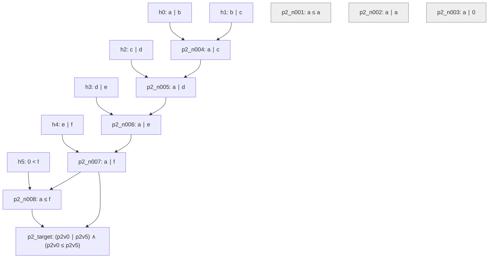

# 运行时多层 Proof DAG 实例

输入：自然数 a,b,c,d,e,f；假设 a∣b、b∣c、c∣d、d∣e、e∣f、0<f；目标 (a∣f)∧(a≤f)。

节点和边来自编译前写入的 planned 事件。本文件只是运行后的可视化，不是规划输入。

[原始事件](D:/mathproof/phase2/benchmarks/run-b63d1f87b59f467a994af289b0ab8390/runs/7a05a163ef664fc684dfdd4e783371f4/events.jsonl) · [完整DAG](D:/mathproof/phase2/benchmarks/run-b63d1f87b59f467a994af289b0ab8390/runs/7a05a163ef664fc684dfdd4e783371f4/dag.json) · [完整Lean源码](D:/mathproof/phase2/benchmarks/run-b63d1f87b59f467a994af289b0ab8390/runs/7a05a163ef664fc684dfdd4e783371f4/attempt-009.lean)



灰色节点是真实编译通过但未进入最终数学证明依赖链的探索分支。全部15节点、12条边均保留。

|节点|数学结论|来源|规划事件|编译开始事件|最终采用|
|---|---|---|---:|---:|---|
|h0|a ∣ b|Input Assumption|2|输入假设|是|
|h1|b ∣ c|Input Assumption|3|输入假设|是|
|h2|c ∣ d|Input Assumption|4|输入假设|是|
|h3|d ∣ e|Input Assumption|5|输入假设|是|
|h4|e ∣ f|Input Assumption|6|输入假设|是|
|h5|0 < f|Input Assumption|7|输入假设|是|
|p2_n001|a ≤ a|Preorder.le_refl|11|12|否|
|p2_n002|a ∣ a|dvd_refl|17|18|否|
|p2_n003|a ∣ 0|dvd_zero|23|24|否|
|p2_n004|a ∣ c|Dvd.dvd.trans|29|30|是|
|p2_n005|a ∣ d|Dvd.dvd.trans|35|36|是|
|p2_n006|a ∣ e|Dvd.dvd.trans|41|42|是|
|p2_n007|a ∣ f|Dvd.dvd.trans|47|48|是|
|p2_n008|a ≤ f|Nat.le_of_dvd|53|54|是|
|p2_target|(p2v0 ∣ p2v5) ∧ (p2v0 ≤ p2v5)|generic conjunction/goal closure|58|59|是|

全部边为 proof_dependency；每条边的数学依据如下。被引用库定理的完整类型及源码位置列于后文。

|前提|结论|依据|
|---|---|---|
|h0|p2_n004|Dvd.dvd.trans|
|h1|p2_n004|Dvd.dvd.trans|
|p2_n004|p2_n005|Dvd.dvd.trans|
|h2|p2_n005|Dvd.dvd.trans|
|p2_n005|p2_n006|Dvd.dvd.trans|
|h3|p2_n006|Dvd.dvd.trans|
|p2_n006|p2_n007|Dvd.dvd.trans|
|h4|p2_n007|Dvd.dvd.trans|
|h5|p2_n008|Nat.le_of_dvd|
|p2_n007|p2_n008|Nat.le_of_dvd|
|p2_n007|p2_target|generic conjunction/goal closure|
|p2_n008|p2_target|generic conjunction/goal closure|

## 实际复用声明

包含未采用探索分支的声明，不与最终复用计数混淆。

### Preorder.le_refl

[源码第41行](D:/mathproof/lean/.lake/packages/mathlib/Mathlib/Order/Defs/PartialOrder.lean:41)

```lean
∀ {α : Type u_2} [self : Preorder α] (a : α), a ≤ a
```

### dvd_refl

[源码第114行](D:/mathproof/lean/.lake/packages/mathlib/Mathlib/Algebra/Divisibility/Basic.lean:114)

```lean
∀ {α : Type u_1} [inst : Monoid α] (a : α), a ∣ a
```

### dvd_zero

[源码第38行](D:/mathproof/lean/.lake/packages/mathlib/Mathlib/Algebra/GroupWithZero/Divisibility.lean:38)

```lean
∀ {α : Type u_1} [inst : SemigroupWithZero α] (a : α), a ∣ 0
```

### Dvd.dvd.trans

[源码第67行](D:/mathproof/lean/.lake/packages/mathlib/Mathlib/Algebra/Divisibility/Basic.lean:67)

```lean
∀ {α : Type u_1} [inst : Semigroup α] {a b c : α}, a ∣ b → b ∣ c → a ∣ c
```

### Nat.le_of_dvd

[源码第56行](D:/mathproof/.tools/lean-4.24.0-windows/src/lean/Init/Data/Nat/Dvd.lean:56)

```lean
∀ {m n : ℕ}, 0 < n → m ∣ n → m ≤ n
```

最终证明使用 Dvd.dvd.trans（Mathlib）和 Nat.le_of_dvd（Lean Core），再用 And.intro 闭合合取。

最终采用5个新生成声明，其中3个是不同于最终子目标的中间引理；数学DAG深度6。3个无关分支仍保留在最终源文件并接受公理审计。

DAG表示数学事实的前提依赖，不是Lean内核全部常量、类型类实例和隐式参数的传递依赖图。所有中间Lean声明显式携带完整输入上下文；这些上下文参数未逐个扩展成数学依赖边。

所有实例化和排序来自开发者编写的通用 Rule Engine；没有项目AI调用，也没有按本题定制证明。
