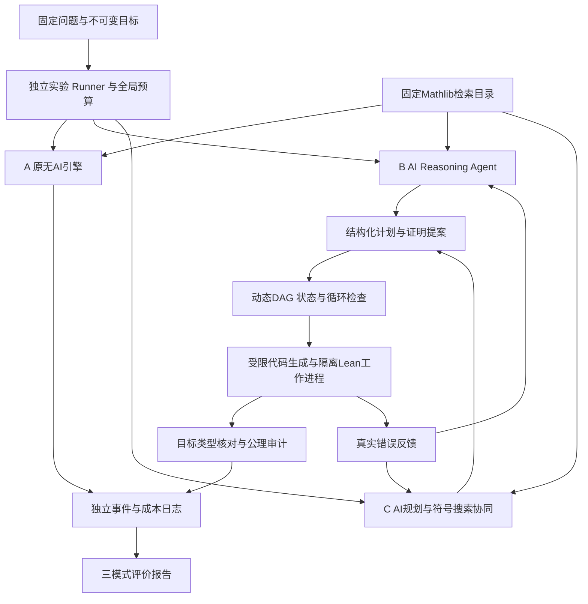

# 独立AI Reasoning Agent与三模式对照实验方案

状态：**设计交付，尚未实施、尚未调用模型。** 现有无AI引擎、旧工作台、数据库、Lemma 1–3及原Benchmark全部保留。此文不是AI能力验收报告。

## 1. 现有接口与新增边界

已检查当前`phase2/model.py`、`retrieval.py`、`planner.py`、`engine.py`、`compiler.py`、`provider.py`及基准数据。当前HTTPAdvice只是自定义JSON建议协议，搜索引擎未调用它；不能把它描述成已经支持模型规划、Lean生成和修复。

建议新建独立包`phase2_ai/`和独立实验根目录`phase2_ai_runs/<batch>/<mode>/<case>/<trial>/`。这些目录本轮尚未创建。现有`phase2`代码保持冻结；通过只读接口与新适配层复用资料，不给Agent任何SQLite连接或旧历史证明读取工具。

现有A直接运行既有引擎。B/C使用新的调度器；C复用通用匹配算法和目录，不通过更改A源码、导入旧Lemma模板或注入目标专用答案实现。

## 2. 模块与可实现接口

|拟新增模块|接口示意|职责与限制|
|---|---|---|
|contracts|GoalSpec、Proposal、PlanDelta、Attempt、Usage|有版本的JSON结构；严格校验未知字段、长度、ID及表达式|
|runner|run(mode, frozen_case, budget, trial)|冻结输入、版本和随机设置；启动独立进程；计时与预算；不覆写旧批次|
|agent|propose(goal, verified_facts, retrieval, feedback)|分析目标、提中间引理、选策略、修改计划、生成证明或请求修复|
|provider|invoke(request) → response + receipt|供应商专用适配器/明确网关协议；不假定任意服务都兼容当前HTTPAdvice|
|retrieval_adapter|search(query, scope) → declaration records|固定目录内检索，记录名称、完整类型、路径、行号、库版本和哈希；AI提到的名称须独立核对|
|dag_controller|apply(plan_delta) → revision|运行中创建节点/边；检查循环、前提和旧节点版本；保存修改/放弃记录|
|bounded_bridge|search_subgoal(goal, facts, remaining_budget)|C模式按剩余统一预算调用通用符号搜索，不能重置子任务预算|
|lean_worker|verify(target_spec, proof_proposal)|隔离执行；目标、完整上下文和导入由受信任包装器确定；真实编译/公理审计|
|feedback|summarize(attempt) → diagnostic packet|保留原始stderr/stdout，只另提供定位摘要；不把模型解释当成编译器结论|
|evaluator|evaluate(attempts, final_certificate)|区分结构目标、原文语义、AI来源和人工入库；计算指标|
|provenance|append(event, hashes, receipts)|每次请求、提案、DAG修订、源码、失败、费用和预算留痕|

对象边界：

- `GoalSpec`：case_id、domain、variables、assumptions、goals、original_text、canonical_target_hash、environment_hash。原文与规范化输入分开；模型不能改写正式验收目标。
- `Proposal`：proposal_id、call_id、action、target_node、statement、premise_node_ids、retrieval_refs、proof_body或受限证明AST、简短依据、uncertainties。只记录简短可核查理由，不要求模型私有思维链。
- `PlanDelta`：add_nodes、add_edges、supersedes、abandon_nodes、requested_search。模型输出只是提案；无权填写verified或approved。
- `Attempt`：源码、声明类型、compile命令/环境、返回码、stdout/stderr、耗时、公理结果、SHA256、目标核对结果、父提案及模型调用ID。
- `Usage`：requested_model、reported_model、reported_version、request_id、输入/输出及缓存token、实际/估算金额、币种、价格表来源与日期、已知/未知标志。

## 3. 三个运行模式

|模式|规划和证明来源|允许的搜索|不会声称的能力|
|---|---|---|---|
|A 无AI有界搜索|原Rule Engine运行时选规则、生成Lean|原固定Nat关系检索与有界前向搜索|没有模型生成或模型错误修复|
|B AI自主生成证明|模型提出计划、中间引理、证明代码并处理错误|只读Mathlib检索；不使用Python有界搜索器替模型完成叶节点|不等同于独立数学原创；复用库定理要标注|
|C AI规划+有界搜索|模型拆分/选策略，符号搜索尝试子目标，模型可据失败改计划|模型生成与通用有界搜索均可；共用总预算|不能把符号搜索生成步骤全部算成AI生成|

B仍通过结构化安全包装生成Lean声明，类型检查和格式拼接不是证明答案模板。为便于归因，首轮所有模式禁止调用宽泛自动证明tactic或隐式外部证明服务；允许的tactic/term集合在实现前冻结并公布。若后续开放`aesop`等通用自动搜索，应作为独立配置重新跑A/B/C并明确归因，不与首轮混合。

三种模式面对同一结构目标、同一库版本和可用目录；类别标签不传给Agent。B/C只能访问题目与通用库声明，不得读取本次baseline的Lean证明、已知DAG、最终答案及旧实验模板。固定七题已公开，仍不能声称严格训练数据去污染或第三方盲测。

## 4. 动态规划和证明闭环

1. Runner验证题目及版本，冻结目标hash和资源账本。Agent对目标的解释保存为建议，不能替换验收命题。
2. 模型通过检索返回的真实声明提出策略、子目标和依赖。不存在的定理名称标为unresolved；不可直接当作已证事实。
3. 每个节点标记来源：Input Assumption、AI Generated、Rule Engine、Mathlib Reuse、Lemma Composition、Human Written；组合步骤可带多个标签。
4. 调度器检查DAG无环，记录planned事件后才生成或编译证明。候选边表示预期依赖；实际通过后另记已验证依赖，不能把期望边当成功依据。
5. 叶节点只能使用输入假设或已验证事实。模型不能通过添加未证明假设、改变量域、缩小量词范围来通过目标。
6. C模式把某个结构子目标交给bounded_bridge；所有匹配、节点和编译消费都进入同一个问题账本，不能每个子目标再获得12次免费编译。
7. 编译失败保存原源码与原错误；模型获得带attempt_id的反馈，输出新proposal/revision。旧尝试只追加标记，不删除。若改变引理声明，建立新节点并使旧依赖失效，不能原位覆写已验证节点。
8. 主目标由已验证节点闭合后独立重编译，核对目标类型/上下文与固定规范等价，再审计目标及全部依赖的公理。证书绑定源码、库、工具链和输入hash。
9. 预算耗尽、服务不可用、编译超时、未能完成规划分别记录原因；数学状态仍为unknown。没有正式反命题/反例证据，不产生refuted。

节点生命周期：proposed → planned → compiling → verified / rejected；被放弃节点为abandoned，依赖失效节点为blocked。只有Lean验证器可以写verified。DAG中的探索分支与最终证明闭包分别输出，便于计算中间引理有效率。

## 5. 模型调用审计

每次实际出站请求前写`ai_request_started`，结束写回执；超时或解析失败同样保留记录。日志必须包括：

- 请求ID、重试/父调用ID、问题及节点ID、时间、模式、预算快照。
- 请求模型名与服务返回模型名/版本分别记录；未返回版本为null，不能用请求名推定版本。
- 实际发送的prompt及检索上下文、参数、完整响应和解析结果；API密钥、Authorization头不得写入日志。
- 可用的输入/输出/缓存token、服务报告费用，以及缺失值。价格推算标estimated，不能称实际账单。
- 对应代码提案hash、DAG修订ID、每次编译ID和结果；模型没有产生代码时明确为null。
- HTTP发送/收到响应/服务报错/取消的状态，以及服务request_id。仅有started记录不能证明模型完成生成；服务返回版本也只是服务提供的元信息，不是独立模型身份鉴定。

解析失败或网络重试的调用也计入调用次数和成本。结果未知可能已计费时标unknown，不能写0。缺少真实配置时模式B/C应返回BLOCKED或NOT RUN，不自动切换到Mock再计为AI成功。

测试桩只能用于协议异常单元测试，单独标synthetic_fixture，不能写入真实实验账本。响应缓存/回放标Replay，不能算作新AI调用或混入实时API耗时。本轮没有调用API，B/C尚无实际成本和能力指标。

## 6. Lean执行与数据保护

AI生成的Lean文本必须视为未受信任代码。当前编译器只接收内部AST生成内容；**不能简单把模型文本直接传给当前Compiler.check并沿用其安全边界**。

新worker应采用两层保护：

1. 受信任包装器固定导入、变量、假设、目标与审计命令。模型只提供proof-body或受限AST；用真正语法解析校验允许的term/tactic形式，拒绝额外命令、import、axiom、unsafe、代码执行、sorry/admit等。正则扫描只能辅助，不能代替语法和内核审计。
2. 单独受限进程/容器或受限账户：无网络、无密钥、无主库访问、库和工具链只读、仅本次输出目录可写，限制内存/时间/子进程。模型服务请求由外层Agent发送，编译进程不继承凭证。若无法建立此隔离，不开放任意AI证明代码执行。

审核必须确认目标常量存在、类型与固定GoalSpec相符、完整上下文未加强、依赖无sorryAx，公理集合符合固定允许策略。禁止用模型自己打印的“成功”文本作为审计结果；应由受信任Lean检查程序读取环境中的声明类型/依赖，再结合真实进程返回码。

原SQLite只读资料也不传给worker；新实验完全独立文件存储。形式目标通过只可设置formal_goal_verified；原文语义未独立确认仍candidate_verified=false，approval_status=pending。新Agent没有批准知识库的接口。

## 7. 对照实验资源协议（拟定值，未执行）

为避免覆盖历史结果，建立新协议`abc-v1`，使用同一七题与新批次。以下是建议的实施默认值，不是原基准已经执行的预算。

|资源|A/B/C共同上限或规则|
|---|---|
|证明编译|每题12次，包括中间节点、失败、修复、最终闭合；独立验收另计|
|单次Lean|最多45秒、内存2GiB，并服从剩余总时间|
|整个题目|300秒墙钟，覆盖调用、检索、规划和编译；到限保存unknown/timeout|
|库与导入|同一固定Lean/Mathlib版本及163条当前适配规则；预热后按相同目录进行检索|
|符号搜索|单轮12000工作单位；每题最多12轮；A/C共享相同语义计数，C子目标不得重置总额|
|DAG节点|每题最多40个，包含模型提案与放弃分支；A原行为保持不变，通过外层监控记账|
|API预算|每题最多12次请求、累计32000输入+输出token、1美元硬预算，先达上限即停止；A不使用API，额度不折换成额外编译|
|并发|单题单worker；同机单线程批次，按轮换次序运行A/B/C|
|人工干预|主榜为0；发生手工改题/改证明须新建assisted实验，不能覆盖自主实验|

API价格和token预占方式须在选择实际服务后依据其计费协议落实；此处1美元仅为预算建议，不是任何模型价格。若无法可靠预估或获取计费，成本字段为unknown，不能声称硬上限得到严格执行；应先完成小规模服务计量验收。

这是相同资源上限，不是强行消耗相同资源。A不用API、B不用有界搜索；应同时报告实际花费及成功率-成本/耗时曲线，不能仅因A费用0而说其他模式无效，也不能隐去模型额外资源。

原A没有总墙钟预算，因此在新协议下由独立Runner管理进程截止时间，不修改A源码。历史A基线仍保留；正式三模式比较时A也按abc-v1新跑，不能拿历史32.419秒直接充当新协议对照。

## 8. 指标的精确定义

|指标|定义|
|---|---|
|首次成功率|该题第一份实际编译证明即证明完整固定目标，且最终重验有效；子目标通过不算|
|最终成功率|预算内完成目标、目标类型核对及公理审计的题数/全部计划题数；基础设施失败另列且不能悄悄剔除|
|Lean编译次数|所有实际证明编译，包括失败和重复；检索编译、独立验收另列|
|平均API成本|全部真实请求含重试的金额/全部题目；未知费用单列，不能填0计算完整平均|
|平均运行时间|从Runner启动问题到最终落盘的完整墙钟；同时分报模型/检索/编译/排队，不混用历史搜索elapsed|
|中间引理可证明率|通过Lean的不同中间命题/提出的不同中间命题；0分母为N/A|
|中间引理采用率|进入成功目标依赖闭包的中间命题/提出的不同中间命题；无成功目标时采用数0|
|人工干预|运行内人工修改目标、提示、证明、预算的次数与内容；开发期工作另列|
|规划价值|有效/放弃节点、DAG深度、成功依赖闭包、相同题三模式差异；深度更大本身不算更优秀|

中间命题以规范化目标和上下文hash去重；原目标、输入假设不计中间引理。相同命题多次代码修复另计attempts。需要同时展示“编译通过但最终没用”的比例，避免用无关事实堆高能力指标。

## 9. 实验流程和验收门槛

实施顺序建议：

1. 先实现独立契约、只追加日志、预算与worker隔离，并测试输入/提示注入、篡改目标、循环DAG、假公理输出、超时、费用未知、失败保存等路径。单元测试桩不算模型能力。
2. 配置一个真实服务适配器，完成一题最小真实调用与计量验收；没有凭证则停在接口验收，B/C明确NOT RUN。
3. 分别实现B和C，保存完整生成来源；验证模型新节点确实在编译前出现，错误修复确有新调用。
4. 使用同七题先做一轮A/B/C小试验。冻结prompt、模型版本、参数和算法后再计划多次试验；建议5轮，但本任务不执行这些运行，也不预先宣称成功。
5. 以独立检查器重验所有成功证明。重验失败时标invalidated，保留原尝试和失败原因；不得挑最好一轮替代全部分布。
6. 报告每题每次结果、实际成本、均值/中位数/范围；7题样本很小，不作广泛数学能力结论。后续另设未见问题集测泛化。

必须通过的防误报检查：假设不得新增；量词/定义域不得被模型改写；Lean失败不能标proved/refuted；服务不可用不能标AI调用成功；所有原始失败可复查；任何模式不能自动批准入库；原引擎/原基准/数据库哈希保护必须通过。

## 10. 下一轮待落实事项

实际服务供应商、模型与版本、计费方式、可用隔离机制尚未选定，因此相关SDK/端点适配、真实调用、B/C能力及费用均NOT VERIFIED。本轮无需填写密钥，也没有读取或测试任何密钥。

当前交付仅为调查、冻结基线和实施方案；未创建新的Agent执行代码、未修改原引擎、未进行大规模API实验。
